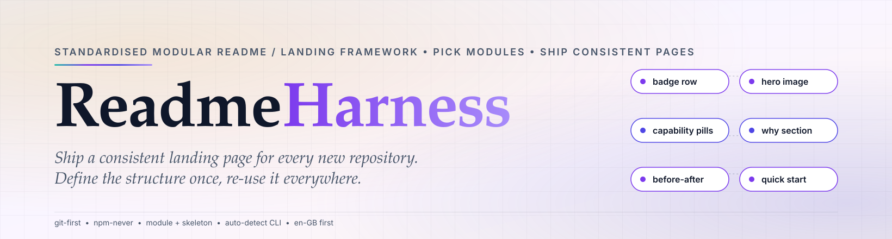

# Readme Harness

**🌐 [English](README.md)**

<a href="https://github.com/Guislabert/readme-harness">
  <picture>
    <source media="(prefers-color-scheme: dark)" srcset="assets/hero-dark.svg">
    
  </picture>
</a>

> 面向项目 **README / Landing 页**的标准化、模块化撰写框架 —— 选模块、套骨架，让每个新仓库都能快速产出规范一致的页面。中文独立页面；主展示页（英文 en-GB）见 `README.md`。灵感致敬 [DeepSeek-Harness][deepseek-harness]，由 **@Guislabert** 维护。

<div align="center">

[][ci]
[][vlg]
[][osi]

`#模块化` `#标准化` `#可复用` `#中文独立页面`

</div>

> [!NOTE]
> 上方徽章行由本框架自身的 `badges-google` 模块生成 —— 用自己渲染自己的页面，作为「模块真实可用」的实证。

---

## 为什么（Why）

每个新仓库都要把同样的 README 从零重写一遍：结构不统一、没有共享的词汇表、每次都在重复做同样的选择。跨多个仓库时页面越差越远 —— 徽章行不一致、链接约定不同、版本纪律各异。

> **Readme Harness 是那个标准化基座**：结构只需定义一次，之后每个新项目都在它之上组装页面。

## 是什么（What）

可插拔的框架，不是单一模板。它提供：

- **骨架（skeleton）** —— 可复制、带注释的 README/Landing 页，每个小节都标好占位符。
- **模块（modules）** —— 可复用、可独立落地的组件（徽章行、能力标签、首图、before/after 佐证…）。
- **注册表（registry）** —— 哪些模块可用的单一信息源。
- **生成器（generator）** —— 一条命令，从骨架 + 所选模块组装出项目 README。

## 目录结构

```
readme-harness/
├── README.md                 #  英文(en-GB)主展示页
├── README.zh-CN.md           #  简体中文独立页(本文件)
├── SPEC.md / SPEC.zh-CN.md   #  框架规范(en / zh-CN)
├── REGISTRY.md / REGISTRY.zh-CN.md  #  模块注册表(en / zh-CN)
├── module/                   #  可插拔模块(每个独立子目录落地)
│   ├── badges-google/        #   Google 四色徽章模块
│   └── badges-meta/          #   带阈值门控的 stars/downloads 徽章
├── skeleton/                 #  可复制的带注释骨架
│   └── README.template.en.md
├── tools/
│   ├── generate.mjs          #  一键生成项目 README 骨架的入口
│   └── version-check.mjs     #  版本链一致性守卫
├── CHANGELOG.md              #  keep-a-changelog 变更日志
├── CHANGELOG.zh-CN.md        #  简体中文变更日志
├── assets/                   #  hero 首图（明暗自适应 SVG）
├── .github/
│   └── workflows/ci.yml      #  CI:版本链 + 模块健全性
└── LICENSE
```

## 模块

| 模块 | 作用 | 落地方式 |
|---|---|---|
| `badges-google` | Google 四色徽章行（CI·Version·npm·License） | `module/badges-google/` |
| `badges-meta` | 带阈值门控的 GitHub 元数据徽章（stars·PRs·downloads） | `module/badges-meta/` |

> 对 `badges-meta`：徽章只在指标**跨过阈值后**才渲染（默认 stars `100`、
> PRs `50`、downloads `500`）—— 所以全新仓库绝不会显示空洞的 `stars 0`。
> npm 徽章只在包真正发布后才渲染（`SPEC.zh-CN.md §4a`）。

> 四色只是一套**语义色板**中的一个实例 —— 需要 5 个以上徽章时的扩展方式见 `module/badges-google/README.zh-CN.md`。

## 快速开始

三步把本框架套用到新仓库：

```sh
# 1. 复制骨架
cp -r skeleton/ my-new-repo/

# 2. 从注册表选模块
cp -r module/badges-google my-new-repo/module/

# 3. 用骨架 + 模块生成 README
node tools/generate.mjs my-new-repo
```

生成器**自动检测**语言/依赖清单（`package.json`、`Cargo.toml`、`go.mod`、
`pyproject.toml`）、版本、CI 工作流，以及已落地的模块。若目标仓库已有
`git remote origin`，它会提取 **owner/repo**，让 CI 徽章与版权行指向真实
GitHub 页面（不留占位符）。暂无 origin？设
`README_HARNESS_OWNER=<你的用户名>`（或先加 origin）再重跑。

除了 README，一次 `generate` 调用还会同时产出 **`AGENTS.md`**（编码代理打开
仓库时读取的 AI 工作契约），以及——若目标仓库声明了任何第三方依赖——一份
**`THIRD_PARTY_NOTICES.md`** 许可证披露，让新仓库一开始就既对代理友好、又
满足许可证再分发合规。

## 采纳规范（Adopting）

`Readme Harness` 遵循 SemVer 版本纪律，由 `tools/version-check.mjs` 统一守卫：
`package.json.version === CHANGELOG 最新小节 === README 徽章`。版本提升是发布节点，而非随便的提交点。详见 [SPEC.zh-CN.md](SPEC.zh-CN.md)。

## 反馈

模块想法、色板问题或缺失的小节，请在 issue 提出。

[ci]: https://github.com/Guislabert/readme-harness/actions
[vlg]: CHANGELOG.md
[osi]: https://opensource.org/licenses/MIT
[deepseek-harness]: https://github.com/deepseek-ai/deepseek-harness

> npm: `readme-harness` 以 **Git-first 方式分发，绝不通过 npm**（无需 npm 账号注册）。包名予以保留，供日后社区确有需要时由维护者替代发布。

## License

MIT © Guislabert